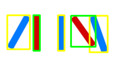
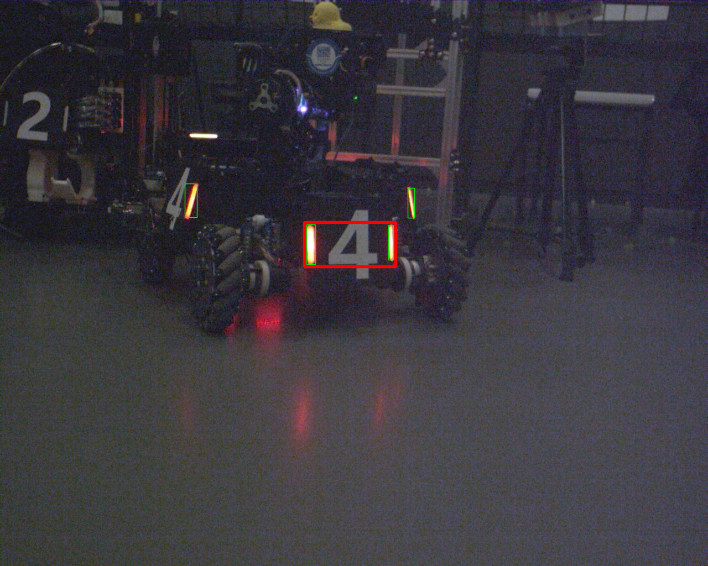

# 视觉第一次作业 —— 图像目标检测

用 OpenCV 完成两个子任务，纯传统视觉方法，不需要训练模型。

| 子任务 | 内容 | 使用图像 |
| --- | --- | --- |
| 任务一 | 用**黄色**框出蓝色矩形区域，用**绿色**框出红色矩形区域 | `images/task1_rects.png` |
| 任务二 | 识别图中的**装甲板灯条**并框选，进一步配成装甲板 | `images/task2_armor.jpg` |

## 目录结构

```
vision-hw1/
├── CMakeLists.txt
├── README.md
├── .gitignore
├── images/                 # 测试图像
│   ├── task1_rects.png
│   └── task2_armor.jpg
├── src/
│   ├── opencv_compat.hpp   # 兼容 OpenCV 4.x / 5.x 的头文件入口
│   ├── imgio.hpp           # 支持中文路径的 imread / imwrite
│   ├── main_task1.cpp      # 任务一
│   └── main_task2.cpp      # 任务二
└── results/                # 运行生成的结果图
    ├── task1_result.png
    ├── task1_mask.png
    ├── task2_result.png
    └── task2_mask.png
```

## 环境

- OpenCV 4.x **或 5.x**（`find_package(OpenCV REQUIRED)`）
- CMake ≥ 3.16
- 支持 C++17 的编译器（MSVC 2019+ / g++ 9+ / clang 10+）

本项目在 **MSVC 19.52（Visual Studio 2026）+ CMake 4.3** 下，分别链接 **OpenCV 4.12.0** 和 **OpenCV 5.1.0** 编译运行通过，均无警告，两张结果图逐像素一致。

> OpenCV 5 把 `contourArea`、`boundingRect`、`minAreaRect` 等形状函数从 `imgproc` 拆到了新的 `geometry` 模块，
> 而 `<opencv2/opencv.hpp>` 不会自动包含它。`src/opencv_compat.hpp` 就是干这件事的：
> 按 `CV_VERSION_MAJOR` 判断是否补 `<opencv2/geometry.hpp>`，让同一份代码在 4.x / 5.x 下都能过编译。

## 编译与运行

```bash
# 在项目根目录
cmake -S . -B build
cmake --build build --config Release
```

CMake 若找不到 OpenCV，手动指定它的配置目录（Windows 预编译包解压后的 `build` 文件夹）：

```bash
cmake -S . -B build -DOpenCV_DIR="C:/opencv/build"
```

在 CLion 里打开工程时，如果提示找不到 OpenCV，在 `Settings → Build, Execution, Deployment → CMake`
的 CMake options 里加一行 `-DOpenCV_DIR=C:/opencv/build` 即可。

> 如果用的是 OpenCV 4.x 但编译器较新（如 VS 2022/2026），配置时可能报
> "Found OpenCV Windows Pack but it has no binaries compatible with your configuration"——
> 这是预编译包只带了 `vc16` 库、而新版 CMake 推算出了别的运行时目录。
> 此时把 `OpenCV_DIR` 直接指到 `x64/vc16/lib` 子目录即可：
> `-DOpenCV_DIR="C:/opencv/build/x64/vc16/lib"`。

运行（在项目根目录执行，程序会自动找 `images/` 和 `results/`）：

```bash
# Windows（Ninja / Makefile 单配置生成器）
build/task1_color_box.exe
build/task2_armor.exe
# Windows（Visual Studio 多配置生成器）
build/Release/task1_color_box.exe
# Linux / macOS
./build/task1_color_box
./build/task2_armor
```

两个程序都支持显式指定输入与输出目录，便于换图测试：

```bash
task1_color_box images/task1_rects.png results
```

> Windows 下若运行报缺少 `opencv_world4xx.dll`：把 `<opencv>/build/x64/vc16/bin` 加入 `PATH`，
> 或把该 dll 复制到 exe 同目录即可。

## 任务一：颜色区域框选

**思路**：颜色分割放在 HSV 空间做，因为明暗变化只体现在 V 通道上，不会像 BGR 那样串色。

1. `BGR -> HSV`。
2. 蓝色掩膜：`H∈[95,140], S≥70, V≥70`，一段区间就够。
3. 红色掩膜：`H∈[0,12]` **并** `H∈[168,180]`。
   红色跨过 0° 分界线（H 在 180 处与 0 相连），只取一段必然漏掉另一半，这是最容易出错的地方。
4. 3×3 开运算去噪点 → `findContours`（只取外轮廓）→ 按面积 ≥ 200 过滤 → `boundingRect` 取外接正矩形。
5. 蓝色画黄框 `BGR(0,255,255)`，红色画绿框 `BGR(0,255,0)`，线宽 2。

**结果**：检出蓝色矩形 3 个、红色矩形 2 个，共 5 个目标，与肉眼计数一致。



原图里有 3 个矩形是倾斜的。按题目"框出矩形区域"的要求，这里统一用**外接正矩形**，
所以倾斜目标的外框会比色块本身大一些、相邻两个框会有重叠——这是正矩形的固有性质，
若要贴合倾斜目标，把 `boundingRect` 换成 `minAreaRect` + 四点绘制即可。

## 任务二：装甲板灯条检测

**难点**：原图是暗光室内照，全图平均灰度只有 **15**，装甲板本体几乎不可见，
唯一稳定的特征是灯条自发光：**亮度接近饱和 + 橙红色 + 竖直细长**。

处理流程：

1. **灯条候选**：HSV 阈值 `H∈[0,35], S≥90, V≥140`。灯条 V 接近 255，与背景分离得很干净。
2. **纵向闭运算**（3×7 竖条核）：灯条常被高光、遮挡切成两段，闭运算把它们连回一根。
3. **形态筛选**：面积 ≥ 60、高度 ≥ 15、长宽比 `h/w ≥ 1.8`，
   用来剔除地面红色倒影、横向光斑和零散噪点。
4. **配对成装甲板**：同一块板上的两根灯条应满足
   - 中心高度差 `|Δy| ≤ 0.5 × 平均灯高`
   - 高度比 ≥ 0.5（透视、遮挡会让两根灯条高度略有差异，但不该差太多）
   - 水平间距 `∈ [0, 3.0 × 平均灯高]`
   
   满足条件的两根灯条按代价 `Δy/H + 0.5·|间距/H − 1.8| + (1 − 高度比)` 取最小者，
   贪心配对，每根灯条只归属一块装甲板。
5. **绘制**：灯条画绿色细框；配对成功的装甲板取两框并集、外扩 4 px，画红色粗框。
   结果底图先做 `gamma=0.5` 提亮，否则暗图上看不清画了什么。

**结果**：检出灯条 4 根，成功配对出装甲板 1 块。



- 画面中央编号 "4" 的装甲板：左右两根灯条成功配对 → 红框。
- 另外 2 根灯条（左侧另一台车的 "4" 板、右上方一块板）只亮了一侧，对侧灯条被结构遮挡或未点亮，
  无法构成一对，因此只保留绿色灯条框，不强行配对——强行配对会得到一个跨半个画面的错误框。

## 参数一览

| 任务 | 参数 | 取值 | 作用 |
| --- | --- | --- | --- |
| 一 | 蓝色 H/S/V | 95–140 / ≥70 / ≥70 | 蓝色分割 |
| 一 | 红色 H | 0–12 与 168–180 | 跨 0° 的红色分割 |
| 一 | 最小面积 | 200 | 去噪点 |
| 二 | 灯条 H/S/V | 0–35 / ≥90 / ≥140 | 橙色高亮分割 |
| 二 | 最小面积 / 高度 | 60 / 15 | 去倒影、光斑 |
| 二 | 长宽比下限 | 1.8 | 只留竖直细长条 |
| 二 | 配对 Δy 上限 | 0.5 × 平均灯高 | 保证水平共线 |
| 二 | 配对间距上限 | 3.0 × 平均灯高 | 防止跨板错配 |

## 鲁棒性说明

- 任务二的阈值在 `V≥110~180`、`S≥70~110` 范围内检出的灯条数量始终是 4 根，
  说明结果对阈值不敏感，不是"调参调出来的个例"。
- 两个程序都把颜色分割的中间掩膜另存为 `*_mask.png`，方便排查漏检/误检。
- **中文路径**：OpenCV 的 `imread` 在 Windows 上走窄字符接口，路径含中文会直接失败，
  因此 `src/imgio.hpp` 先用 `ifstream` 把文件读进内存再 `imdecode`；文件名编码先按 UTF-8 解释，
  失败再按本机 ANSI 代码页（GBK）重试，所以"工程放在中文目录下"和"命令行传中文路径"两种情形都能正常读写
  （u8path 遇到非法 UTF-8 会抛异常，代码里已做兜底，不会崩）。
- 程序在项目根目录、`build/` 目录下运行都能自动找到 `images/` 和 `results/`（逐级向上探测）。
- 已知局限：任务二完全依赖"灯条亮着"这一先验。若灯条熄灭或画面过曝，
  传统方法就失效了，那种场景需要上检测网络（如 YOLO）；
  另外 `kIdealGapRatio=1.8` 是按大装甲板估计的经验值，换小装甲板需要调整。

## 提交清单

| 要求 | 对应位置 |
| --- | --- |
| 源码 | `src/main_task1.cpp`、`src/main_task2.cpp`、`src/imgio.hpp`、`src/opencv_compat.hpp` |
| CMakeList | `CMakeLists.txt` |
| 测试图像 | `images/task1_rects.png`、`images/task2_armor.jpg` |
| 结果图像 | `results/task1_result.png`、`results/task2_result.png`（另有 `*_mask.png` 为中间掩膜） |
